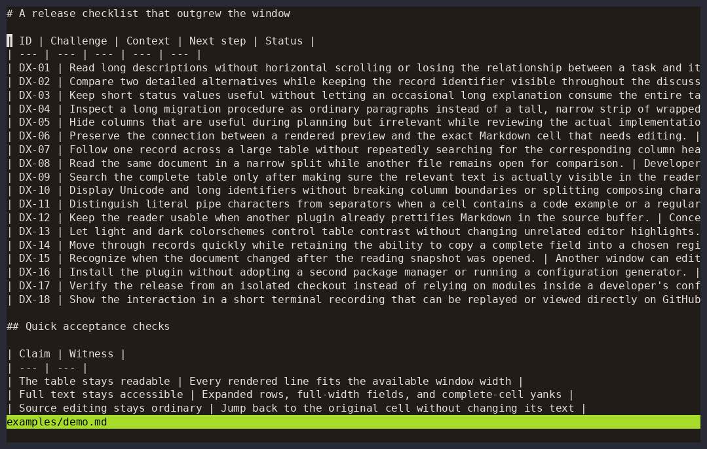

# md-table.nvim

Read prose-heavy Markdown tables at your window's width. Hide columns, trim
previews, expand rows, or read a record as full-width fields. Source stays untouched.



**Neovim 0.10+ (tested on 0.12.5). No dependencies.**

## Install

Lazy:

```lua
{ "freeo/md-table.nvim", cmd = "MdTable",
  keys = { { "<leader>mt", "<cmd>MdTable<cr>", desc = "Read table" } } }
```

Native package manager (Neovim 0.12+):

```lua
vim.pack.add({ "https://github.com/freeo/md-table.nvim" })
vim.keymap.set("n", "<leader>mt", "<cmd>MdTable<cr>")
```

Older Neovim: clone into `stdpath("data")/site/pack/plugins/start/md-table.nvim`.
No `setup()` required.

## Read

Run `:MdTable` inside a table; elsewhere it offers a table picker. Headers stay
visible. Cells start with three-line previews; narrow windows use row view.

| Keys | Action |
| --- | --- |
| `j/k`, `h/l` or `Tab` | Move between rows and columns |
| `Enter`, `w`, `c` | Expand row, wrap all rows, cut column to one line |
| `x`, `u`, `a` | Hide column, restore one, show all |
| `f`, `v`, `R` | Focus column + first column, row view, reset |
| `y`, `g` | Copy complete cell, jump to source |
| `?`, `q` | Help, close |

Reopen after source edits. `/` searches visible text; `a` then `w` exposes the
whole table. Details: `:help md-table`.

## Rendering and themes

Works alongside [render-markdown.nvim](https://github.com/MeanderingProgrammer/render-markdown.nvim):
it renders the Markdown source; this plugin reads raw buffer text into a separate
`mdtable` scratch buffer. Keep `mdtable` out of its `file_types`. Neither plugin
needs to disable the other.

Colorschemes can define `MdTable*` groups directly; native fallback links respect
overrides. See [`:help md-table-highlights`](doc/md-table.txt) for all groups.

Standalone pipe tables only; nested containers and HTML tables aren't supported.
[Replay recording](assets/demo.cast) · [Tests and demo recipe](doc/md-table.txt)
